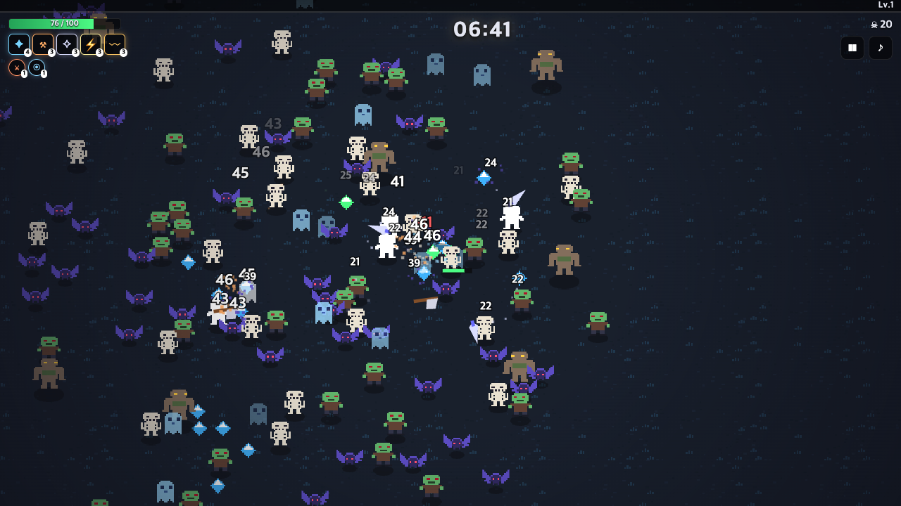

# 🌙 Moonlit Survivors

뱀파이어 서바이벌(Vampire Survivors) 스타일의 **브라우저 생존 액션 게임**.
달빛 아래 끝없이 몰려오는 괴물 무리를 뚫고 **15분을 버티면 승리**합니다.

**▶ 바로 플레이: https://jwdev1995.github.io/moonlit-survivors/**

<p align="center"></p>

## 특징
- **자동 공격, 이동만 조작** — 키보드(WASD/방향키) 또는 터치 조이스틱
- **캐릭터 3종** (기사 / 마법사 / 도적), 각각 다른 시작 무기와 특성
- **무기 6종 × Lv.6** — 마법 화살, 채찍, 성수 오라, 투척 도끼, 회전 칼날, 번개
- **패시브 9종** — 체력·속도·피해·쿨다운·범위·자석·방어·회복·투사체 증폭
- **적 5종 + 보스 3회** (5:00 / 10:00 / 13:30), 떼 돌파·포위 링 이벤트
- 하트·자석·폭탄 드롭, 보스 보물상자
- 픽셀 아트 스프라이트·효과음을 모두 코드로 생성 (외부 에셋·라이브러리·빌드 도구 없음)
- 최고 기록 로컬 저장, PC/모바일 반응형

## 조작
| 입력 | 동작 |
|---|---|
| `WASD` / `←↑↓→` | 이동 |
| 터치 드래그 | 가상 조이스틱 |
| `P` / `ESC` | 일시정지 |
| `M` | 음소거 |
| `1` `2` `3` | 레벨업 선택 |

## 로컬 실행
정적 파일이라 서버 없이 `index.html`을 열어도 동작합니다. (권장: 간단한 정적 서버)
```bash
python3 -m http.server 8080
# → http://localhost:8080
```

## 구조
```
index.html        화면/HUD 마크업
css/style.css     스타일
js/config.js      밸런스 데이터 (캐릭터·무기·패시브·적·스폰 테이블)
js/sprites.js     픽셀 스프라이트 정의 + 캔버스 캐시
js/weapons.js     무기 로직/렌더링
js/spawner.js     스폰 페이즈·이벤트·보스
js/game.js        게임 루프·충돌·렌더링
js/ui.js          HUD·레벨업 카드·화면 전환
docs/GDD.md       게임 기획서
```
밸런스 조정은 `js/config.js` 한 곳에서 끝납니다.

## 기획 문서
[docs/GDD.md](docs/GDD.md) — 컨셉, 핵심 루프, 캐릭터/무기/적 테이블, 스폰 타임라인, UI/기술 설계.

## 라이선스
MIT
